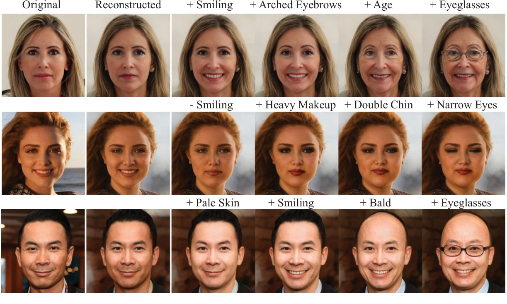
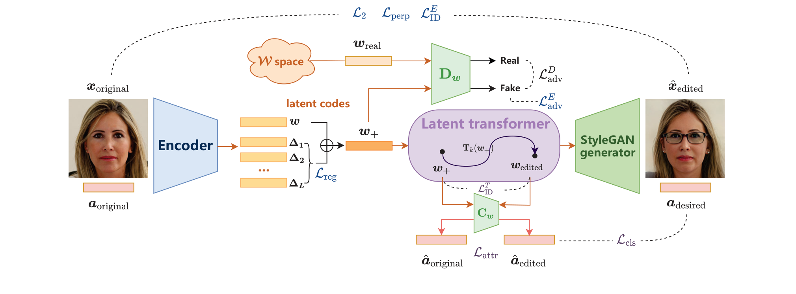
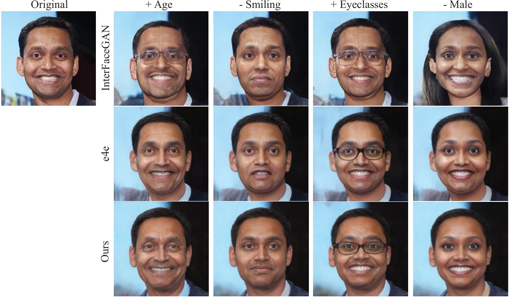

<div align="center">

# VR-FAM: Variance-Reduced Encoder with Nonlinear Transformation for Facial Attribute Manipulation

[**Yifan Yuan**](https://yifanyuan.com) · **Siteng Ma** · **Junping Zhang**<sup>&dagger;</sup>

Shanghai Key Lab of Intelligent Information Processing, School of Computer Science, Fudan University
<br>
<sup>&dagger;</sup>Corresponding author

**ICASSP 2022**

<a href="https://doi.org/10.1109/ICASSP43922.2022.9746046"></a>
<a href="https://github.com/Sherlockyyf/DO-FAM"></a>
<a href="https://pytorch.org"></a>
<a href="LICENSE"></a>

[English](README.md) · [简体中文](README_zh.md)

</div>

<p align="center"><br><em>真实人脸上的连续属性编辑。</em></p>

**一句话总结：** 基于 StyleGAN 的人脸属性编辑（FAM）框架，兼顾 FAM 的三项要求：*编辑能力*、*失真*和*保真度*。**方差缩减编码器**让反演得到的 W+ 编码贴近 StyleGAN 的 W 空间，**非线性潜码变换网络**再把编码推向目标属性，同时保持身份和其他属性不变。

## 🔍 方法

<p align="center"></p>

VR-FAM 由方差缩减编码器、非线性潜码变换网络和 StyleGAN2 生成器组成：

- **方差缩减编码器（论文 2.1 节）。** 编码器（pSp / e4e 结构）输出 $w^+ = (w, w+\Delta_1, \dots, w+\Delta_{L-1})$：先只学单个编码 $w$，再逐个学习残差 $\Delta_i$。对残差施加 L2 惩罚 $\mathcal{L}_{reg} = \sum_i \lVert\Delta_i\rVert_2$，减小各层风格编码之间的方差；潜码判别器 $D_W$（非饱和损失 + R1 正则）让它们落在 $W$ 的分布内。重建由 $\mathcal{L}_2$、LPIPS 和 ArcFace 身份损失监督。
- **非线性潜码变换（论文 2.2 节）。** 每个属性 $a_k$ 对应一个网络 $T_k(w^+, \alpha) = w^+ + \alpha \cdot f(w^+)$，其中 $f$ 是非线性函数（每个风格层三层全连接）。训练时借助预训练的潜码属性分类器 $C$：对目标属性施加分类损失，对其他属性施加保持损失，并按属性相关性以 $1-|\gamma_{ik}|$ 加权。

## 🛠️ 安装

```bash
git clone https://github.com/Sherlockyyf/VR-FAM.git
cd VR-FAM
conda env create -f environment.yml && conda activate vrfam      # 或：pip install -r requirements.txt
```

StyleGAN2 的算子用纯 PyTorch 实现，不需要编译任何扩展。

## 📦 预训练模型

把下列文件放到 `pretrained_models/` 下。

| 模型 | 说明 | 下载 |
|:-|:-|:-:|
| `stylegan2-ffhq-config-f.pt` | StyleGAN2 FFHQ 1024×1024 生成器（rosinality 格式） | [pSp 模型库](https://github.com/eladrich/pixel2style2pixel#pretrained-models) |
| `model_ir_se50.pth` | IR-SE50 ArcFace，用于身份损失和指标 | [pSp 模型库](https://github.com/eladrich/pixel2style2pixel#pretrained-models) |
| `vr_encoder_celebahq.pt` | VR-FAM 方差缩减编码器 | 即将发布 |
| `latent_classifier.pth` | 潜码属性分类器（40 个 CelebA 属性） | 即将发布 |
| `transformers/tnet_<Attribute>.pth` | 非线性潜码变换网络 | 即将发布 |
| `shape_predictor_68_face_landmarks.dat` | dlib 人脸关键点，仅用于对齐自然场景照片 | [dlib](http://dlib.net/files/shape_predictor_68_face_landmarks.dat.bz2) |

官方 [e4e 编码器](https://github.com/omertov/encoder4editing)和 [Latent Transformer](https://github.com/InterDigitalInc/latent-transformer) 的潜码分类器也可以直接加载；原始线性 latent transformer 的权重（`tnet_<index>.pth.tar`）会在加载时自动转换。

## 🚀 快速开始

编辑已对齐的人脸图像（FFHQ 对齐方式；自然场景照片可在 `invert.py` 里加 `--align`）：

```bash
# 单个属性、多个强度：输入 | 重建 | 编辑结果
python scripts/edit.py --encoder pretrained_models/vr_encoder_celebahq.pt --transformers pretrained_models/transformers \
    --images path/to/aligned_faces --attr Smiling --alphas -1.5 -1 -0.5 0.5 1 1.5 --output outputs/smiling

# 连续编辑：每一列多叠加一个属性
python scripts/edit.py --encoder pretrained_models/vr_encoder_celebahq.pt --transformers pretrained_models/transformers \
    --images path/to/aligned_faces --edits "Smiling=1,Arched_Eyebrows=1,Young=-1,Eyeglasses=1.5" --output outputs/sequential
```

<details>
<summary><b>Python API</b></summary>

```python
import torch
from vrfam.models import VREncoder
from vrfam.editor import LatentEditor
from vrfam.data import encoder_transforms
from vrfam.utils import tensor2im
from PIL import Image

net = VREncoder.from_checkpoint('pretrained_models/vr_encoder_celebahq.pt').cuda().eval()
editor = LatentEditor('pretrained_models/transformers', device='cuda', edit_layers=11)

x = encoder_transforms(train=False)(Image.open('face.png').convert('RGB')).unsqueeze(0).cuda()
with torch.no_grad():
    w = net.encode(x)                                        # [1, 18, 512]
    w_edit = editor.sequential_edit(w, [('Smiling', 1.0), ('Eyeglasses', 1.5)])
    image = net.synthesize(w_edit, resize=False)[0]          # 1024 x 1024
tensor2im(image).save('edited.png')
```
</details>

属性名沿用 CelebA 的命名（`Smiling`、`Male`、`Young`、`Eyeglasses`、`Bald`、`Bangs` 等）；`Gender` 和 `Age` 分别是 `Male` 和 `Young` 的别名。

## 🏋️ 训练

**1. 数据。** 训练用 [CelebA-HQ](https://github.com/tkarras/progressive_growing_of_gans)（属性标注来自 [CelebAMask-HQ](https://github.com/switchablenorms/CelebAMask-HQ)），测试用 [FFHQ](https://github.com/NVlabs/ffhq-dataset)，都按 FFHQ 方式对齐。

```text
data/
├── celeba_hq/train/          # 0.jpg ...（按 CelebA-HQ 编号命名）
├── ffhq/test/
└── CelebAMask-HQ/CelebAMask-HQ-attribute-anno.txt
```

**2. 方差缩减编码器。** 前 20K 步只训练 `w`，之后每 2K 步加入一个残差（batch 4，Adam 1e-4，λ<sub>ℓ2</sub>=1，λ<sub>perp</sub>=0.8，λ<sub>ID</sub>=0.1，λ<sub>reg</sub>=2e-4，λ<sub>adv</sub>=0.1，见 `configs/encoder.yaml`）：

```bash
python scripts/train_encoder.py --config configs/encoder.yaml --exp_dir experiments/vr_encoder
```

**3. 潜码与标签。**

```bash
python scripts/invert.py --checkpoint experiments/vr_encoder/checkpoints/best_model.pt \
    --input data/celeba_hq/train --output inversion/celeba_hq_train
python scripts/prepare_celebahq_labels.py --anno data/CelebAMask-HQ/CelebAMask-HQ-attribute-anno.txt \
    --images_dir data/celeba_hq/train --output inversion/celeba_hq_train/labels.npy
```

**4. 潜码分类器**（9216 → 2048 → 512 → 40）：

```bash
python scripts/train_classifier.py --latents inversion/celeba_hq_train/latents.npy \
    --labels inversion/celeba_hq_train/labels.npy --exp_dir experiments/classifier
```

**5. 非线性潜码变换网络**（每个属性一个，见 `configs/transformer.yaml`）：

```bash
python scripts/train_transformer.py --latents inversion/celeba_hq_train/latents.npy \
    --labels inversion/celeba_hq_train/labels.npy --classifier experiments/classifier/latent_classifier.pth \
    --exp_dir experiments/transformers --attributes Smiling Male Young Eyeglasses
```

论文式 (8) 的身份损失需要在训练中合成图像，可用 `--opts lambda.id=1.0 --generator pretrained_models/stylegan2-ffhq-config-f.pt` 开启。

## 📊 评测

```bash
python scripts/edit.py ... --attr Smiling --alphas 1.0 --save_individual --output outputs/eval   # 写入 outputs/eval/Smiling_1/
python scripts/evaluate.py --source_dir data/ffhq/test --result_dir outputs/eval/Smiling_1 --metrics l2 lpips msssim id fid
```

| 方法 | 失真 (L2) ↓ | 感知质量 (FID) ↓ | 可编辑性 (FID) ↓ |
|:-|:-:|:-:|:-:|
| InterFaceGAN | 0.049 | 74.92 | 130.23 |
| e4e | 0.053 | **30.96** | **81.08** |
| **VR-FAM（本文）** | **0.041** | 32.21 | 83.75 |

<p align="center"><br><em>与 InterFaceGAN 和 e4e 的对比。</em></p>

## 📁 仓库结构

```text
vrfam/
├── models/
│   ├── stylegan2/             # StyleGAN2 生成器（纯 PyTorch 算子）
│   ├── encoders/              # IR-SE50 主干、渐进式 e4e 编码器
│   ├── vr_encoder.py          # 方差缩减编码器（编码器 + 生成器 + 平均潜码）
│   ├── discriminator.py       # 潜码判别器 D_W
│   ├── latent_classifier.py   # 潜码属性分类器 C
│   └── latent_transformer.py  # 非线性潜码变换网络 T
├── trainers/                  # 编码器 / 变换网络的训练循环
├── losses.py · editor.py · metrics.py · data.py · alignment.py
scripts/                       # prepare_celebahq_labels · train_encoder · invert · train_classifier
                               # train_transformer · edit · evaluate
configs/                       # encoder.yaml · classifier.yaml · transformer.yaml
```

## ✅ TODO

- [x] 训练与推理代码
- [ ] 预训练权重

## 📝 引用

```bibtex
@inproceedings{yuan2022vrfam,
  title     = {{VR-FAM}: Variance-Reduced Encoder with Nonlinear Transformation for Facial Attribute Manipulation},
  author    = {Yuan, Yifan and Ma, Siteng and Zhang, Junping},
  booktitle = {IEEE International Conference on Acoustics, Speech and Signal Processing (ICASSP)},
  pages     = {1755--1759},
  year      = {2022},
  doi       = {10.1109/ICASSP43922.2022.9746046}
}
```

## 📄 许可证

[MIT](LICENSE)。第三方代码保留其原有许可证（见 `licenses/`）。
